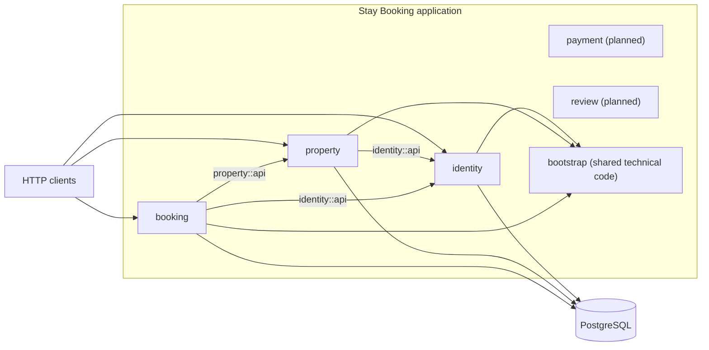

# Stay Booking

Backend application for an accommodation booking service built with Spring Boot. The project uses Java 21, Maven, PostgreSQL, Spring Data JPA, Flyway, Spring Security, and Actuator.

## Module status

| Module | Status | Current scope |
| --- | --- | --- |
| `bootstrap` | Implemented | Shared technical types, configuration, and error handling. |
| `identity` | Implemented | Registration, login, JWT authentication, roles, and current actor API. |
| `property` | Implemented | Property management, amenities, images, catalog, and booking facts API. |
| `booking` | Partial | Booking creation and PostgreSQL overlap protection; payment flow is pending. |
| `payment` | Planned | Module package only; no payment use cases yet. |
| `review` | Planned | Module package only; no review use cases yet. |

## Architecture

This is one Spring Boot application with Spring Modulith package boundaries and one PostgreSQL database. Business modules access each other through their named `api` interfaces; their `internal` packages stay private. Flyway owns the schema.



## Requirements

- JDK 21
- Docker with Docker Compose
- OpenSSL (to generate a local JWT secret)

You do not need to install Maven separately because the project includes Maven Wrapper.

## Local Development

1. Start PostgreSQL:

   ```bash
   docker compose up -d --wait postgres
   ```

2. Set the required JWT signing secret in the terminal where you will run the application:

   ```bash
   export JWT_SECRET_BASE64="$(openssl rand -base64 32)"
   ```

   In PowerShell, use `$env:JWT_SECRET_BASE64 = (openssl rand -base64 32)`.

   `JWT_SECRET_BASE64` must be valid Base64 encoding of at least 32 random bytes (256 bits). It is required for every profile and has no default. Reuse the same secret across restarts to keep existing tokens valid.

3. Run the application with the local profile:

   ```bash
   ./mvnw spring-boot:run -Dspring-boot.run.profiles=local
   ```

   On Windows, use `mvnw.cmd` instead of `./mvnw`.

The application will be available at `http://localhost:8080`. Its health endpoint at `http://localhost:8080/actuator/health` requires a valid JWT access token in the `Authorization: Bearer <token>` header.

The default database connection uses the `staybooking` database, username `user`, password `password`, and port `5432`. You can override these settings with the `DB_URL`, `DB_USERNAME`, and `DB_PASSWORD` environment variables.

Docker must be running for the local PostgreSQL service and for tests that use PostgreSQL Testcontainers.

## Build and Test

```bash
# Run all tests from a clean state
./mvnw clean test

# Run tests and build the executable JAR
./mvnw clean verify

# Build without running tests
./mvnw clean package -DskipTests

# Remove build artifacts
./mvnw clean
```

The packaged JAR is created at `target/stay-booking-0.0.1-SNAPSHOT.jar`. With `JWT_SECRET_BASE64` set as described above, run it with:

```bash
java -jar target/stay-booking-0.0.1-SNAPSHOT.jar --spring.profiles.active=local
```

## Production Profile

The `prod` profile uses external database credentials and a JWT signing secret. The identity/security foundation is implemented: registration, login, current-user lookup, BCrypt password hashing, stateless JWT access tokens, and role authorization.

The Property rich aggregate supports creation, details and price/capacity updates, activation/deactivation, admin block/unblock and host reassignment, soft deletion, amenity selection, and image metadata. Changes to an existing property require an `If-Match` version ETag. The cross-module Property API is available. Booking creation is implemented; Payment and Review use cases are pending.

Database connection variables and `JWT_SECRET_BASE64` are required when using the `prod` profile. Supply a persistent JWT secret from your secret manager:

```bash
DB_URL='jdbc:postgresql://<db-host>:5432/staybooking' \
DB_USERNAME='<db-user>' \
DB_PASSWORD='<value-from-secret-manager>' \
JWT_SECRET_BASE64='<base64-encoded-secret-from-secret-manager>' \
java -jar target/stay-booking-0.0.1-SNAPSHOT.jar --spring.profiles.active=prod
```

## Property Catalog

`GET /api/properties` is public and returns `items`, zero-based `page`, `size`, `totalElements`, and `totalPages`. Each item is a summary with `id`, `createdAt`, `title`, `country`, `city`, `pricePerNight`, `maxGuests`, and `status`; amenities and images are available only from the detail endpoint.

- Optional filters: `city` (trimmed, case-insensitive exact match), inclusive `minPrice` and `maxPrice`, and `minGuests` (minimum capacity). Invalid or inverted ranges return `400`.
- The default and `status=ACTIVE` show only active properties. `status=INACTIVE` and `status=BLOCKED` require an administrator; anonymous requests receive `401`, and other users receive `403`. Soft-deleted properties never appear.
- `page` defaults to `0`; `size` defaults to `20` and accepts `1..100`. Repeat `sort=field,direction` to sort by multiple fields in request order. Supported fields are `createdAt`, `pricePerNight`, and `title`; directions are `asc` and `desc`. The default is `createdAt,desc`. The property ID is appended as a tie-breaker for stable pages. Invalid pagination or sorting returns `400`.

For example, `GET /api/properties?city=Kyiv&minPrice=100&minGuests=2&page=0&size=10&sort=pricePerNight,asc&sort=title,desc` returns the first page of matching active properties.

The catalog uses composable Spring Data JPA `Specification` predicates because several independent optional filters would make derived repository methods or fixed JPQL combinations cumbersome. Native SQL is unnecessary for these Property fields. Offset pagination selects a scalar DTO projection inside a read-only transaction, so list mapping does not load amenity or image collections. Hibernate's soft-delete restriction applies to both page rows and their count. Detail mapping loads its collections within the service transaction. PostgreSQL integration tests check that SQL statement counts stay bounded as a catalog page grows and for detail with populated relations.

## Property Module API

`property.api.PropertyApi.findForBooking(propertyId)` returns an `Optional<PropertyBookingView>` containing only `id`, `hostId`, `pricePerNight` (`Money` with scale 2), `maxGuests`, and `bookable`. Active properties are bookable; inactive and blocked properties return a view with `bookable=false`. Missing and soft-deleted properties return `Optional.empty()`.

Consumers depend on `property::api`; the implementation and repository remain internal. Add a field to this contract only when a confirmed consumer business requirement needs it. The API supplies Property facts without checking booking dates or interval availability.

## Booking Creation

An authenticated `GUEST` can create a booking with `POST /api/bookings` and a JSON body containing `propertyId` (UUID), `checkIn` and `checkOut` (ISO dates), and positive `numberOfGuests`. `checkOut` must be later than `checkIn`; `checkIn` may be today or later. The property must exist, be active, and accommodate the guests. The server determines `guestId`, price, and status.

The response is `201 Created` with `id`, `propertyId`, `guestId`, dates, guest count, `pricePerNightSnapshot`, `totalPrice`, and `status: "PENDING_PAYMENT"`. There is no `Location` header until a Booking GET endpoint exists. Invalid input returns `400`, a missing token `401`, a non-guest token `403`, a missing or deleted property `404`, and an inactive or blocked property `409`. These errors use the existing `ProblemDetail` format.

This creates a pending record; it does not process payment or confirm the stay. `PENDING_PAYMENT` and `CONFIRMED` bookings occupy their half-open date ranges; `CANCELLED`, `PAYMENT_FAILED`, and `COMPLETED` do not. The range `[checkIn, checkOut)` excludes checkout day, so one stay can end when another begins. A known overlap or exclusion violation returns a safe `409 ProblemDetail`.

The early overlap query improves the response for dates already occupied, but two applications can both see an empty range before either inserts. Flyway migration `V7` adds a PostgreSQL exclusion constraint on `property_id` equality and overlapping (`&&`) `daterange(check_in, check_out, '[)')`. `btree_gist` supplies GiST equality for UUID property IDs. The constraint's partial predicate applies only to `PENDING_PAYMENT` and `CONFIRMED`, matching the application's occupied-date policy. PostgreSQL enforces it for every writer to the table, including concurrent or direct writes that bypass the query.

Pessimistic locking would require all writers to lock the same shared row; optimistic locking would require a shared version check and handling version conflicts. Both rely on every writer following that protocol. `SERIALIZABLE` transactions require a retry policy for serialization failures, and advisory locks require all writers to acquire the same lock. The exclusion constraint expresses the invariant in the shared database without those application-level protocols.

Applying `V7` to an existing database requires permission to install the `btree_gist` extension. If existing occupied bookings overlap, the migration fails without changing those bookings; resolve the conflicts before applying it. If later stages change which statuses occupy dates, update the domain policy, overlap query, and constraint together through a new migration.

## Stop the Environment

```bash
docker compose down
```

To also delete the PostgreSQL data, run `docker compose down -v`.
