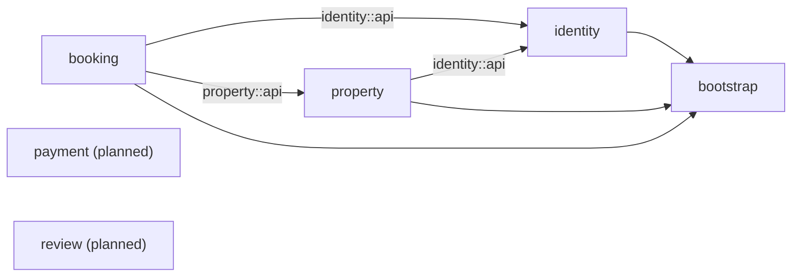

# Stay Booking

Stay Booking is an accommodation booking API built with Java 21, Spring Boot, Spring Modulith, and PostgreSQL. Hosts publish properties, and guests create bookings for available dates. The application uses Spring Data JPA, Flyway, Spring Security with JWTs, and Actuator.

## Run with Docker Compose

You need Docker running with Docker Compose and OpenSSL to generate a local signing secret. From the repository root, run the following in Bash:

```bash
export JWT_SECRET_BASE64="$(openssl rand -base64 32)"
docker compose up --build --wait
docker compose ps
```

Both `app` and `postgres` should report `healthy`. Compose runs the app with the `prod` profile and passes `JWT_SECRET_BASE64` to the container at runtime. The secret must be Base64 encoding of at least 32 bytes (256 bits) and is required in every profile.

To reuse the secret across shells, save the generated value as `JWT_SECRET_BASE64=<value>` in the git-ignored `.env`. An exported value takes precedence over the file. Reusing the same key keeps existing tokens valid until they expire. Use the settings template in [.env.example](.env.example).

To customize the Compose database settings, set `DB_NAME`, `DB_USERNAME`, and `DB_PASSWORD` in `.env`. Compose uses these values for both services. The PostgreSQL image uses them when initializing a new volume. To change the credentials for an existing volume, update them in PostgreSQL as well.

The API is available at `http://localhost:8080`. The app container checks HTTP and database access through the public catalog at `GET /api/properties?size=1`. The [HTTP walkthrough](#http-walkthrough) checks Actuator health with a JWT.

## Local development

Install JDK 21 for local development. The included Maven Wrapper handles Maven. If the Compose app is running, free port 8080 with `docker compose stop app`.

1. Start PostgreSQL:

   ```bash
   docker compose up -d --wait postgres
   ```

2. Export the signing secret in the terminal where you will run Maven. To start with a new local secret, run:

   ```bash
   export JWT_SECRET_BASE64="$(openssl rand -base64 32)"
   ```

   In PowerShell, use `$env:JWT_SECRET_BASE64 = (openssl rand -base64 32)`.

   If you saved a secret in `.env`, export that same value for Maven. Compose reads `.env` automatically. The Spring Boot process reads its configuration from the shell environment.

3. Run the application with the local profile:

   The default connection is `jdbc:postgresql://localhost:5432/staybooking` with username `user` and password `password`. If you overrode the Compose defaults, export matching values before running Maven. Use the Compose `DB_NAME` as the last segment of `DB_URL`.

   ```bash
   export DB_URL='jdbc:postgresql://localhost:5432/custom_staybooking'
   export DB_USERNAME='custom_user'
   export DB_PASSWORD='your-compose-password'
   ```

   Replace the example values with your Compose settings. In PowerShell, set the variables with `$env:DB_URL`, `$env:DB_USERNAME`, and `$env:DB_PASSWORD`.

   ```bash
   ./mvnw spring-boot:run -Dspring-boot.run.profiles=local
   ```

   On Windows, use `mvnw.cmd` instead of `./mvnw`.

The same API is available at `http://localhost:8080`.

## OpenAPI

The UI and specs are public for GET requests and cover implemented Identity, Property, Amenity, and Booking operations.

- [Swagger UI](http://localhost:8080/swagger-ui.html)
- [OpenAPI JSON](http://localhost:8080/v3/api-docs)
- [OpenAPI YAML](http://localhost:8080/v3/api-docs.yaml)

For protected operations, click **Authorize** in Swagger UI and enter the JWT from `POST /api/auth/login` for the role you need.

## HTTP walkthrough

Run these commands in the same Bash session with the app running. The examples use `curl`, `jq`, and OpenSSL. Each run creates two demo accounts with fresh addresses, one property, and one booking.

### Register and log in as a host and a guest

```bash
BASE_URL='http://localhost:8080'
DEMO_ID="$(openssl rand -hex 6)"
DEMO_PASSWORD='Demo-password-42'
HOST_EMAIL="host-${DEMO_ID}@example.com"
GUEST_EMAIL="guest-${DEMO_ID}@example.com"

register() {
  curl -fsSi "$BASE_URL/api/auth/register" \
    -H 'Content-Type: application/json' \
    --data "$(jq -nc --arg email "$1" --arg password "$DEMO_PASSWORD" --arg role "$2" \
      '{email: $email, password: $password, role: $role}')"
}

register "$HOST_EMAIL" HOST
register "$GUEST_EMAIL" GUEST
```

Each registration returns `201 Created` and a JSON user with an `id`, `email`, and the requested `role`.

```bash
login() {
  curl -fsS "$BASE_URL/api/auth/login" \
    -H 'Content-Type: application/json' \
    --data "$(jq -nc --arg email "$1" --arg password "$DEMO_PASSWORD" \
      '{email: $email, password: $password}')"
}

HOST_TOKEN="$(login "$HOST_EMAIL" | jq -er '.token')"
GUEST_TOKEN="$(login "$GUEST_EMAIL" | jq -er '.token')"
```

Each login returns `200 OK` with a JWT in `token` and `"type": "Bearer"`. The commands save the tokens for the next requests.

### Create and activate a property as the host

```bash
PROPERTY_HEADERS="$(mktemp)"
PROPERTY_BODY="$(curl -fsS -D "$PROPERTY_HEADERS" "$BASE_URL/api/properties" \
  -H "Authorization: Bearer $HOST_TOKEN" \
  -H 'Content-Type: application/json' \
  --data '{
    "title": "Quiet apartment",
    "country": "Ukraine",
    "city": "Kyiv",
    "address": "Khreshchatyk 1",
    "pricePerNight": 120.00,
    "maxGuests": 4
  }')"
cat "$PROPERTY_HEADERS"
printf '%s\n' "$PROPERTY_BODY" | jq .
PROPERTY_ID="$(jq -er '.id' <<< "$PROPERTY_BODY")"
PROPERTY_ETAG="$(awk 'tolower($1) == "etag:" { sub(/\r$/, "", $2); print $2 }' "$PROPERTY_HEADERS")"
rm "$PROPERTY_HEADERS"
```

Expect `201 Created`, `Location: /api/properties/<id>`, and a strong `ETag: "0"`. The JSON includes the new `id` and `"status": "INACTIVE"`.

```bash
curl -fsSi -X PATCH "$BASE_URL/api/properties/$PROPERTY_ID/activate" \
  -H "Authorization: Bearer $HOST_TOKEN" \
  -H "If-Match: $PROPERTY_ETAG"
```

Activation returns `204 No Content` with a new `ETag`. The command passes the original ETag including its double quotes. The property is now `ACTIVE` and can be booked.

### Book two nights as the guest

The request uses tomorrow as check-in and a checkout two days later, based on UTC.

```bash
BOOKING_BODY="$(jq -nc --arg propertyId "$PROPERTY_ID" '
  now as $now
  | {
      propertyId: $propertyId,
      checkIn: ($now + 86400 | strftime("%Y-%m-%d")),
      checkOut: ($now + 259200 | strftime("%Y-%m-%d")),
      numberOfGuests: 2
    }')"

curl -fsSi "$BASE_URL/api/bookings" \
  -H "Authorization: Bearer $GUEST_TOKEN" \
  -H 'Content-Type: application/json' \
  --data "$BOOKING_BODY"
```

Expect `201 Created` with the booking `id`, the property and guest IDs, the requested dates and guest count, `pricePerNightSnapshot` of 120.00, `totalPrice` of 240.00, and `"status": "PENDING_PAYMENT"`.

### Check health and a booking conflict

```bash
curl -fsSi "$BASE_URL/actuator/health" \
  -H "Authorization: Bearer $GUEST_TOKEN"
```

Expect `200 OK` with `{"status":"UP"}`. A request without a valid JWT returns `401 Unauthorized`.

Repeat the same booking to see the overlap error:

```bash
curl -sSi "$BASE_URL/api/bookings" \
  -H "Authorization: Bearer $GUEST_TOKEN" \
  -H 'Content-Type: application/json' \
  --data "$BOOKING_BODY"
```

Expect `409 Conflict` with `Content-Type: application/problem+json` and a body containing these fields. The server generates `requestId` for each error.

```json
{
  "type": "about:blank",
  "title": "Conflict",
  "status": 409,
  "detail": "Dates are unavailable for this property",
  "code": "CONFLICT",
  "path": "/api/bookings",
  "requestId": "d63af4c2-fb37-45e1-90fb-a7df880d4ec7"
}
```

The same client-safe detail is returned if PostgreSQL detects the overlap during insertion. Bean Validation errors also include an `errors` array with `field` and `message` entries.

## Architecture

This is a modular monolith with one Spring Boot deployment, one Maven build, and one PostgreSQL database. The arrows show Java module dependencies. Business modules use small named `api` contracts and keep implementations in `internal`.



The module tests run `ApplicationModules.verify()`, check that all six modules are detected, and check that Property exposes only `PropertyApi` and `PropertyBookingView` through its named API. See [ModularityTest](src/test/java/dev/noren/staybooking/ModularityTest.java).

| Module | Current scope |
| --- | --- |
| `bootstrap` | Shared technical types, configuration, and error handling. |
| `identity` | Registration, login, BCrypt password hashing, stateless JWT authentication, roles, and the current actor API. |
| `property` | Property management, amenities, images, public catalog, and the booking facts API. |
| `booking` | Booking creation and database-enforced overlap protection. |
| `payment` | Planned. |
| `review` | Planned. |

The JPA entities also serve as rich domain aggregates. `Property` owns activation, deactivation, blocking, host reassignment, soft deletion, and updates to details, amenities, and image metadata. It validates changes before mutating state. Its `@Version` backs the strong ETag required for changes to an existing property. `Booking.create` validates dates, capacity, and bookability and snapshots the nightly and total prices. The application services handle authorization, transactions, and persistence around those domain operations.

The shared PostgreSQL database gives the application local transactions and lets the database enforce cross-module referential integrity. Booking stores `propertyId` and `guestId` as UUIDs with foreign keys to `properties` and `users`. These keys couple schema changes across modules and require coordinated migrations. See [V6](src/main/resources/db/migration/booking/V6__create_bookings_table.sql).

Java module boundaries use IDs and immutable API views, with JPA associations confined to their owning module. Flyway owns the schema and Hibernate validates the mappings on startup.

## Build and Test

Run tests with JDK 21 and Docker available for PostgreSQL Testcontainers.

```bash
# Run all tests from a clean state
./mvnw clean test

# Run tests and build the executable JAR
./mvnw clean verify

# Build without running tests
./mvnw clean package -DskipTests

# Remove build artifacts
./mvnw clean
```

The packaged JAR is created at `target/stay-booking-0.0.1-SNAPSHOT.jar`. With `JWT_SECRET_BASE64` set as described above, run it with:

```bash
java -jar target/stay-booking-0.0.1-SNAPSHOT.jar --spring.profiles.active=local
```

## Production Profile

The `prod` profile requires external database settings and `JWT_SECRET_BASE64`. Supply the database credentials and a persistent JWT secret from your secret manager.

```bash
DB_URL='jdbc:postgresql://<db-host>:5432/staybooking' \
DB_USERNAME='<db-user>' \
DB_PASSWORD='<value-from-secret-manager>' \
JWT_SECRET_BASE64='<base64-encoded-secret-from-secret-manager>' \
java -jar target/stay-booking-0.0.1-SNAPSHOT.jar --spring.profiles.active=prod
```

## Property Catalog

`GET /api/properties` is public and returns `items`, zero-based `page`, `size`, `totalElements`, and `totalPages`. Each item is a summary with `id`, `createdAt`, `title`, `country`, `city`, `pricePerNight`, `maxGuests`, and `status`; amenities and images are available only from the detail endpoint.

- Optional filters: `city` (trimmed, case-insensitive exact match), inclusive `minPrice` and `maxPrice`, and `minGuests` (minimum capacity). Invalid or inverted ranges return `400`.
- The default and `status=ACTIVE` show only active properties. `status=INACTIVE` and `status=BLOCKED` require an administrator; anonymous requests receive `401`, and other users receive `403`. Soft-deleted properties never appear.
- `page` defaults to `0`; `size` defaults to `20` and accepts `1..100`. Repeat `sort=field,direction` to sort by multiple fields in request order. Supported fields are `createdAt`, `pricePerNight`, and `title`; directions are `asc` and `desc`. The default is `createdAt,desc`. The property ID is appended as a tie-breaker for stable pages. Invalid pagination or sorting returns `400`.

For example, `GET /api/properties?city=Kyiv&minPrice=100&minGuests=2&page=0&size=10&sort=pricePerNight,asc&sort=title,desc` returns the first page of matching active properties.

The catalog uses composable Spring Data JPA `Specification` predicates because several independent optional filters would make derived repository methods or fixed JPQL combinations cumbersome. Native SQL is unnecessary for these Property fields. Offset pagination selects a scalar DTO projection inside a read-only transaction, so list mapping does not load amenity or image collections. Hibernate's soft-delete restriction applies to both page rows and their count. Detail mapping loads its collections within the service transaction. PostgreSQL integration tests check that SQL statement counts stay bounded as a catalog page grows and for detail with populated relations.

## Property Module API

`property.api.PropertyApi.findForBooking(propertyId)` returns an `Optional<PropertyBookingView>` containing only `id`, `hostId`, `pricePerNight` (`Money` with scale 2), `maxGuests`, and `bookable`. Active properties are bookable; inactive and blocked properties return a view with `bookable=false`. Missing and soft-deleted properties return `Optional.empty()`.

Consumers depend on `property::api`; the implementation and repository remain internal. Add a field to this contract only when a confirmed consumer business requirement needs it. The API supplies Property facts without checking booking dates or interval availability.

## Booking Creation

An authenticated `GUEST` can create a booking with `POST /api/bookings` and a JSON body containing `propertyId` (UUID), `checkIn` and `checkOut` (ISO dates), and positive `numberOfGuests`. `checkIn` may be today or later in UTC, and `checkOut` must be later than `checkIn`. The property must exist, be active, and accommodate the guests. The server determines `guestId`, price, and status.

The response is `201 Created` with `id`, `propertyId`, `guestId`, dates, guest count, `pricePerNightSnapshot`, `totalPrice`, and `status: "PENDING_PAYMENT"`. There is no `Location` header until a Booking GET endpoint exists. Invalid input returns `400`, a missing token `401`, a non-guest token `403`, a missing or deleted property `404`, and an inactive or blocked property `409`. These errors use the existing `ProblemDetail` format.

Creation reserves dates in `PENDING_PAYMENT`. Payment and confirmation are planned. The occupied statuses are `PENDING_PAYMENT` and `CONFIRMED`. The range `[checkIn, checkOut)` excludes checkout day, so one stay can end when another begins.

The early overlap query catches dates that are already occupied. Two concurrent transactions can both see a free range before either inserts. Migration `V7` adds a PostgreSQL exclusion constraint on `property_id` equality and overlapping (`&&`) `daterange(check_in, check_out, '[)')`. The `btree_gist` extension supplies GiST equality for UUID property IDs. The partial predicate matches the occupied statuses, and PostgreSQL enforces the rule for every writer. See [V7](src/main/resources/db/migration/booking/V7__prevent_overlapping_active_bookings.sql).

The database concurrency test gives two independent transactions overlapping dates for the same property and asserts that only one commits. The concurrent HTTP test makes both requests pass the overlap query and asserts one `201 Created` and one safe `409 Conflict`. See [BookingDatabaseGuaranteeTest](src/test/java/dev/noren/staybooking/booking/BookingDatabaseGuaranteeTest.java) and [BookingHttpIntegrationTest](src/test/java/dev/noren/staybooking/booking/BookingHttpIntegrationTest.java).

Pessimistic locking would require all writers to lock the same shared row; optimistic locking would require a shared version check and handling version conflicts. Both rely on every writer following that protocol. `SERIALIZABLE` transactions require a retry policy for serialization failures, and advisory locks require all writers to acquire the same lock. The exclusion constraint expresses the invariant in the shared database without those application-level protocols.

Applying `V7` to an existing database requires permission to install the `btree_gist` extension. If existing occupied bookings overlap, the migration fails without changing those bookings; resolve the conflicts before applying it. If later stages change which statuses occupy dates, update the domain policy, overlap query, and constraint together through a new migration.

## Stop the Environment

```bash
docker compose down
```

To also delete the PostgreSQL data, run `docker compose down -v`.
